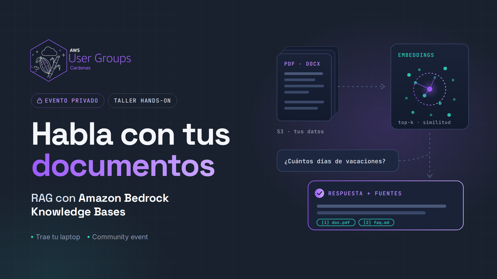
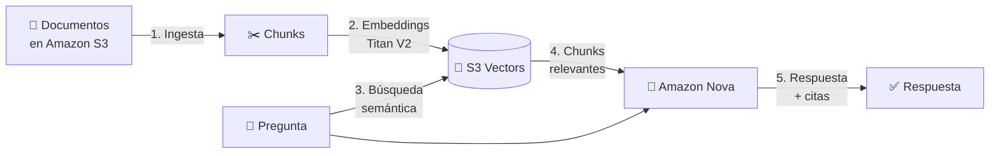

# 🧠 Habla con tus documentos: RAG con Amazon Bedrock Knowledge Bases



> Taller práctico de **2 horas** del **AWS User Group Cárdenas**.
> Aprende desde cero a construir un asistente que responde preguntas sobre **tus propios documentos** y **cita sus fuentes**.

---

## ¿Qué vas a construir?

Un asistente de preguntas y respuestas sobre los documentos internos de **Cacao Labs**, una startup ficticia de Cárdenas, Tabasco. Al terminar, podrás preguntarle cosas como:

- *"¿Cuántos días de vacaciones tengo en mi primer año?"*
- *"¿Cómo pido un reembolso de gastos de viaje?"*
- *"¿Qué hago si pierdo mi laptop de la empresa?"*

El asistente te contestará **usando solo la información de los documentos** y te dirá **de qué archivo sacó cada dato**.



## Cómo está organizado

| # | Módulo | Tiempo | Tipo |
|---|---|---|---|
| 0 | [Prerrequisitos y entorno](docs/00-prerrequisitos/README.md) | 10 min | Setup |
| 1 | [Conceptos: ¿qué es RAG?](docs/01-conceptos.md) | 15 min | Teoría |
| 2 | [Prepara tus datos en S3](docs/02-preparar-datos.md) | 10 min | 🛠️ Hands-on |
| 3 | [Crea tu Knowledge Base](docs/03-crear-knowledge-base.md) | 20 min | 🛠️ Hands-on |
| 4 | [Pruébala en la consola](docs/04-probar-en-consola.md) | 15 min | 🛠️ Hands-on |
| 5 | [Consúltala con Python](docs/05-consultar-con-python.md) | 25 min | 🛠️ Hands-on |
| 6 | [Retos: ajusta y mejora](docs/06-retos.md) | 15 min | 🏆 Reto |
| 7 | [Limpieza de recursos](docs/07-limpieza.md) | 5 min | ⚠️ Obligatorio |
| 8 | [¿Qué sigue?](docs/08-que-sigue.md) | 5 min | Cierre |

¿Algo falló? Revisa [Solución de problemas](docs/troubleshooting.md).
¿Vas a impartir el taller? Lee la [Guía del instructor](docs/guia-instructor.md).

## Requisitos

- Laptop con navegador actualizado (Chrome, Edge o Firefox).
- Acceso a una cuenta de AWS. Puede ser:
  - **Cuenta de evento** que te da el instructor (no pagas nada), o
  - **Tu propia cuenta** (el costo estimado es **menor a 1 USD** si haces la [limpieza](docs/07-limpieza.md)).
- Python básico (deseable, no obligatorio). Todo el código ya está escrito y lo vas a ejecutar en **AWS CloudShell**, así que **no necesitas instalar nada**.

## Servicios que vas a usar

| Servicio | Para qué |
|---|---|
| **Amazon S3** | Guardar los documentos fuente |
| **Amazon Bedrock Knowledge Bases** | Orquestar todo el flujo de RAG |
| **Amazon Titan Text Embeddings V2** | Convertir texto en vectores |
| **Amazon S3 Vectors** | Guardar y buscar los vectores |
| **Amazon Nova 2 Lite** | Generar la respuesta final |
| **AWS CloudShell** | Terminal en el navegador con Python y boto3 |

## Estructura del repositorio

```
.
├── README.md                 ← estás aquí
├── docs/                     ← paso a paso del taller
├── data/                     ← documentos de ejemplo de "Cacao Labs"
│   └── extra/                ← documento para el reto de re-sincronización
├── scripts/                  ← scripts de Python para el módulo 5
├── site/index.html           ← esta misma guía como página web interactiva
└── slides/                   ← presentación del taller en PDF
```

> 🌐 **Versión web:** activa GitHub Pages en *Settings → Pages* con la carpeta `/site` (o copia `site/index.html` a la raíz de la rama `gh-pages`). La página incluye navegación por módulos, botones para copiar código y una lista de progreso que se guarda en tu navegador.

## Créditos y licencia

Creado por **AWS User Group Cárdenas** con el apoyo de **XpectreLabs Comunidad**.
El formato está inspirado en los workshops oficiales de [AWS Workshop Studio](https://workshops.aws/).

Contenido bajo licencia [MIT](LICENSE). Cacao Labs es una empresa ficticia. Cualquier parecido con la realidad es coincidencia.

> ⚠️ Este no es material oficial de Amazon Web Services. AWS y Amazon Bedrock son marcas de Amazon.com, Inc. o sus afiliadas.

---

**[Empezar → Prerrequisitos](docs/00-prerrequisitos/README.md)**
