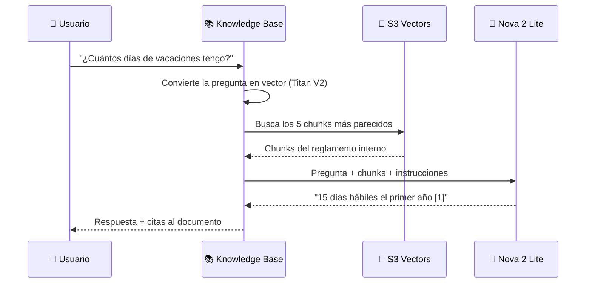

# 1 · Conceptos: ¿qué es RAG?

⏱️ **15 minutos** · Teoría (el instructor lo explica con las slides)

## El problema

Los modelos de lenguaje (LLMs) como Amazon Nova, Claude o GPT saben **muchísimo**, pero tienen tres limitaciones:

1. **No conocen tus datos.** Nunca leyeron el reglamento de tu empresa, tus manuales ni tus contratos.
2. **Tienen fecha de corte.** Su conocimiento se congela el día que terminaron de entrenarlos.
3. **Pueden inventar.** Cuando no saben algo, a veces responden con mucha seguridad algo falso. A esto se le llama **alucinación**.

## La solución: RAG

**RAG** significa *Retrieval-Augmented Generation*, o **generación aumentada con recuperación**. La idea es sencilla:

> Antes de que el modelo responda, **busca** en tus documentos la información relevante y **se la da** junto con la pregunta.

Es como un examen **a libro abierto**: el modelo no tiene que memorizar tu reglamento, solo tiene que saber buscar y leer.

## Las piezas de un sistema RAG

### 1. Documentos fuente
Tus archivos: PDF, Word, Markdown, HTML, CSV… En este taller viven en **Amazon S3**.

### 2. Chunking (fragmentación)
Un documento completo es demasiado grande para buscar con precisión. Por eso se divide en **chunks** (fragmentos) de unos cientos de palabras.

> 💡 Si los chunks son muy chicos, pierden contexto. Si son muy grandes, mezclan temas y la búsqueda es menos precisa.

### 3. Embeddings
Un **embedding** es una lista de números (un **vector**) que representa el **significado** de un texto. Textos con significado parecido tienen vectores cercanos, aunque usen palabras distintas:

| Texto | ¿Cercano a "días de vacaciones"? |
|---|---|
| "periodo de descanso anual" | ✅ Muy cercano |
| "prima vacacional del 50 %" | ✅ Cercano |
| "reembolso de taxi" | ❌ Lejano |

En este taller usamos **Amazon Titan Text Embeddings V2**, que entiende español.

### 4. Base de datos vectorial
Guarda los vectores y permite buscar los **más parecidos** a la pregunta (**búsqueda semántica**). Usamos **Amazon S3 Vectors**.

### 5. Modelo generador
Recibe la pregunta y los chunks encontrados, y redacta una respuesta en lenguaje natural. Usamos **Amazon Nova 2 Lite**.

## El flujo completo

## ¿Y qué hace Amazon Bedrock Knowledge Bases?

Construir todo esto a mano requiere mucho código: leer archivos, partirlos, llamar al modelo de embeddings, guardar en la base vectorial, mantenerla sincronizada y armar el prompt.

**Bedrock Knowledge Bases lo hace por ti** como servicio administrado:

| Tú haces | Bedrock hace |
|---|---|
| Subes documentos a S3 | Los lee y los parte en chunks |
| Eliges el modelo de embeddings | Genera y guarda los vectores |
| Presionas **Sync** | Detecta archivos nuevos, modificados y borrados |
| Llamas a una API | Busca, arma el prompt, genera la respuesta y agrega citas |

## Glosario rápido

| Término | Significado |
|---|---|
| **LLM** | Modelo de lenguaje grande. Genera texto. |
| **Chunk** | Fragmento de un documento. |
| **Embedding** | Vector numérico que representa el significado de un texto. |
| **Top-k** | Cuántos chunks se recuperan por pregunta. |
| **Score** | Qué tan parecido es un chunk a la pregunta. |
| **Ingesta / Sync** | Proceso de leer, fragmentar e indexar los documentos. |
| **Cita** | Referencia al documento del que salió un dato. |

---

**[← Prerrequisitos](00-prerrequisitos/README.md)** · **[Siguiente: Prepara tus datos →](02-preparar-datos.md)**
