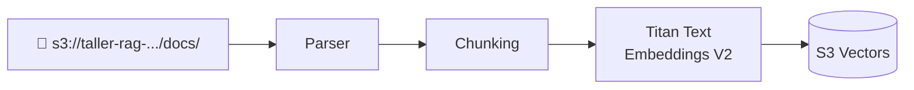

# 3 · Crea tu Knowledge Base

⏱️ **20 minutos** · 🛠️ Hands-on

## Objetivo

Crear una **Knowledge Base** en Amazon Bedrock que lea tus documentos de S3, los fragmente, genere los embeddings con **Titan V2** y los guarde en **S3 Vectors**.



> 💡 La consola de AWS cambia seguido. Si un botón tiene un nombre un poco distinto al de esta guía, busca la opción equivalente.

## Paso 1 · Abre Knowledge Bases

1. En la barra de búsqueda de la consola escribe **Bedrock** y abre **Amazon Bedrock**.
2. Confirma que estás en **us-east-1 (N. Virginia)**.
3. En el menú izquierdo, busca la sección **Build** (o *Builder tools*) y haz clic en **Knowledge Bases**.
4. Haz clic en **Create** → **Knowledge Base with vector store**.

## Paso 2 · Detalles de la Knowledge Base

| Campo | Valor |
|---|---|
| **Knowledge Base name** | `kb-cacao-labs` |
| **Description** | `Documentos internos de Cacao Labs` |
| **IAM permissions** | ✅ *Create and use a new service role* (deja el nombre que propone) |
| **Data source** | ✅ *Amazon S3* |

Haz clic en **Next**.

> 🔐 El **service role** es una identidad que Bedrock usa para leer tu bucket y escribir en la base vectorial. Bedrock lo crea con los permisos mínimos necesarios.

## Paso 3 · Configura la fuente de datos

| Campo | Valor |
|---|---|
| **Data source name** | `docs-cacao-labs` |
| **S3 URI** | Haz clic en **Browse S3** y elige `taller-rag-<tu-cuenta>/docs/` |
| **Parsing strategy** | *Amazon Bedrock default parser* |
| **Chunking strategy** | *Default chunking* |

Haz clic en **Next**.

> 💡 **Default chunking** divide el texto en fragmentos de ~300 tokens. En los retos verás qué pasa si cambias esta estrategia.

## Paso 4 · Modelo de embeddings y base vectorial

### Modelo de embeddings

1. Haz clic en **Select model**.
2. Elige **Amazon** → **Titan Text Embeddings V2**.
3. En **Additional configurations** deja *Embeddings type* = **Floating-point vector embeddings** y *Vector dimensions* = **1024**.

### Base de datos vectorial

1. Elige **Quick create a new vector store**.
2. En el tipo de base vectorial, elige **Amazon S3 Vectors**.

> ⚠️ **Importante:** elige **S3 Vectors**. Si eliges *Amazon OpenSearch Serverless*, se cobra **por hora** aunque no lo uses.

Haz clic en **Next**.

## Paso 5 · Revisa y crea

1. Revisa el resumen.
2. Haz clic en **Create Knowledge Base**.
3. Espera de 1 a 3 minutos mientras Bedrock crea el rol, el bucket de vectores y el índice. ☕

Cuando termine verás un mensaje verde de éxito.

## Paso 6 · Sincroniza (ingesta)

Crear la Knowledge Base **no** procesa los documentos todavía. Para eso hay que **sincronizar**:

1. En la página de tu Knowledge Base, baja a la sección **Data source**.
2. Selecciona `docs-cacao-labs`.
3. Haz clic en **Sync**.
4. Espera a que el estado pase a **Available** / **Completed** (menos de 1 minuto con estos documentos).

### ¿Qué pasó durante el Sync?

1. Bedrock leyó los 4 documentos y sus metadatos desde S3.
2. Los partió en chunks.
3. Calculó el embedding de cada chunk con Titan V2.
4. Guardó cada vector, con su texto y metadatos, en S3 Vectors.

> 💡 Haz clic en el **sync job** para ver cuántos documentos se escanearon, indexaron o fallaron.

## Paso 7 · Guarda el ID de tu Knowledge Base

En la sección **Knowledge Base overview** copia el **Knowledge Base ID**. Es un código de 10 caracteres, por ejemplo `ABCD1234EF`.

En CloudShell:

```bash
export KB_ID="PEGA_AQUI_TU_ID"
echo "Mi Knowledge Base: $KB_ID"
```

> ⚠️ Las variables de entorno se pierden si CloudShell se reinicia. Si un script dice "Falta la variable KB_ID", vuelve a ejecutar el `export`.

## ✅ Checkpoint

- [ ] Mi Knowledge Base `kb-cacao-labs` aparece con estado **Available**.
- [ ] El último sync dice **Completed** con 4 documentos indexados.
- [ ] Guardé el `KB_ID` en CloudShell.

---

**[← Prepara tus datos](02-preparar-datos.md)** · **[Siguiente: Pruébala en la consola →](04-probar-en-consola.md)**
