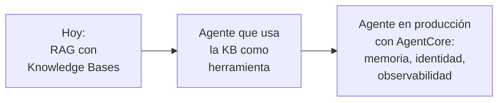

# 8 · ¿Qué sigue?

⏱️ **5 minutos** · Cierre

## 🎉 ¡Lo lograste!

En dos horas:

- ✅ Entendiste qué es RAG y por qué los LLMs lo necesitan.
- ✅ Subiste documentos a S3 y creaste una Knowledge Base con S3 Vectors.
- ✅ Consultaste tu Knowledge Base desde la consola y desde Python.
- ✅ Agregaste memoria de conversación, un prompt personalizado y filtros por metadatos.
- ✅ Comprobaste que sin RAG el modelo inventa.

## De RAG a agentes

Lo que construiste **responde preguntas**. El siguiente nivel son los **agentes de IA**: sistemas que, además de consultar tu Knowledge Base, **toman acciones** con herramientas. Por ejemplo, un agente podría:

- Leer la política de vacaciones **y** registrar tu solicitud en "Jícara".
- Revisar la política de gastos **y** validar si una factura cumple.
- Recordar tus preferencias entre conversaciones.

Para llevar un agente a producción, AWS ofrece **Amazon Bedrock AgentCore**: hospedaje, memoria, identidad, herramientas y observabilidad para agentes.

## Para seguir aprendiendo

| Recurso | Enlace |
|---|---|
| Documentación de Bedrock Knowledge Bases | https://docs.aws.amazon.com/bedrock/latest/userguide/knowledge-base.html |
| Workshops oficiales de AWS | https://workshops.aws/ |
| Ejemplos oficiales de Bedrock | https://github.com/aws-samples |
| AWS Builder Center | https://builder.aws.com/ |

## Únete a la comunidad

**AWS User Group Cárdenas** organiza talleres, pláticas y meetups. Síguenos en Builder Center para enterarte del próximo evento. 💜

¿Te gustó el taller? ⭐ Dale una estrella a este repositorio y compártelo.

## Tu opinión

Nos ayuda mucho saber qué mejorar. Responde la encuesta que compartirá el instructor al final del evento.

---

**[← Limpieza](07-limpieza.md)** · **[Volver al inicio](../README.md)**
